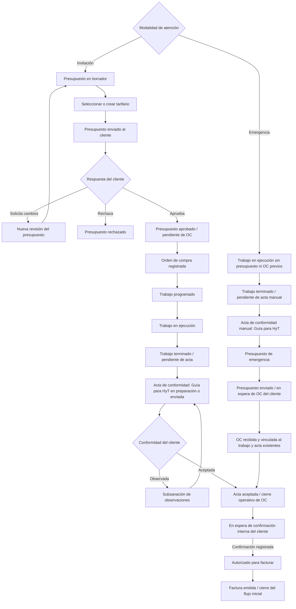

# Gestión de Servicios

Levantamiento de procesos y propuesta funcional

Versión: 0.6 — denominación interna del acta y ajuste del contenido del PDF

Fecha: 24/10/2026

Estado: documento para revisión del cliente

Cliente: H Y T Servicios Generales E.I.R.L.

Elaborado por: FralseTech

## Índice de lectura y entregables documentales

| Parte | Contenido | Entregable para revisión |
|---|---|---|
| 1. Antecedentes | Situación actual, propósito y fuentes del levantamiento | Contexto del proyecto. |
| 2. Análisis del proceso actual | Necesidades y requisitos informados por el negocio | Levantamiento de procesos y necesidades. |
| 3. Diagramas, estados y fechas de seguimiento | Flujos por invitación y emergencia, condiciones de avance y fechas por acción | Diagrama de proceso y matriz de seguimiento. |
| 4. Solución propuesta | Objetivo, mejoras esperadas y organización del expediente | Propuesta funcional de solución. |
| 5. Especificación funcional del aplicativo | Módulos, mantenimientos, documentos, usuarios, pantallas y reportes | Descripción de lo que permitirá hacer el aplicativo. |
| 6. Especificación técnica preliminar | Datos, seguridad, archivos, operación e integraciones por definir | Base de requisitos técnicos para el diseño posterior. |
| 7. Alcance, entregables y validación | Alcance inicial, matriz de entregables, decisiones pendientes y criterios de aceptación | Base de revisión y acuerdo del alcance con el cliente. |
| 8. Identidad visual y control documental | Logos guardados y criterios para la próxima edición del PDF | Referencias de presentación de la propuesta. |

Las partes 1 a 4 explican el problema, el proceso y la mejora propuesta. La parte 5 describe el funcionamiento esperado del aplicativo; la parte 6 presenta los aspectos técnicos que se definirán después de validar el proceso. La parte 7 diferencia los entregables de documentación de la futura implementación. La parte 8 conserva las referencias visuales.

## 1. Antecedentes

### 1.1 Situación actual

La empresa presta servicios a sus clientes mediante dos modalidades: atención de invitaciones a cotizar y atención de emergencias. Para completar cada servicio intervienen presupuestos, tarifarios, órdenes de compra del cliente, ejecución de trabajos, actas de conformidad y confirmaciones internas del cliente previas a la facturación.

Actualmente, estos pasos se administran de forma manual o mediante archivos de Excel. Según lo indicado durante el levantamiento, esta forma de trabajo dificulta el manejo y control de la información, así como la consulta de antecedentes de servicios realizados. Para conocer la situación completa de una atención es necesario revisar y relacionar los documentos y registros disponibles.

La consulta histórica resulta poco amigable: identificar presupuestos anteriores, trabajos completados, órdenes con conformidad o servicios pendientes de factura requiere una revisión manual. Esta dificultad aumenta la necesidad de contar con una vista consolidada que permita seguir cada servicio desde su origen hasta la facturación.

### 1.2 Propósito y base del documento

El **acta de conformidad (Guía para HyT)** corresponde al documento que la empresa denomina internamente **«Guía para HyT»**. Ambas denominaciones se refieren al mismo documento y conservan las mismas funciones y estados descritos en este levantamiento.

Este documento presenta el proceso informado por el negocio, los campos identificados y las mejoras propuestas para que el cliente pueda revisarlos y validar el alcance. Distingue los requisitos confirmados de las propuestas y decisiones pendientes.

La base del levantamiento es la explicación del negocio y la imagen del presupuesto de H Y T Servicios Generales E.I.R.L. El formato se utiliza como referencia de campos y presentación; sus textos y valores de ejemplo deberán validarse antes de convertirse en reglas del sistema. No se dispone todavía del archivo Excel original ni de sus hojas auxiliares. La selección tecnológica y el mecanismo de facturación se definirán en una etapa posterior.

## 2. Análisis del proceso actual

### 2.1 Necesidades identificadas

- Consultar en un solo lugar la información del cliente, sus tiendas, contactos y servicios atendidos.
- Identificar el estado de cada atención y el documento o confirmación que falta para continuar.
- Relacionar presupuesto, OC, trabajo realizado, acta de conformidad y factura, aunque se registren en diferente orden en una emergencia.
- Recuperar información histórica por cliente, tienda, fechas, documentos y descripción del servicio.
- Conocer los presupuestos ganados y seguir su avance hasta la facturación.
- Facilitar el seguimiento de trabajos completados que aún requieren conformidad o confirmación del cliente.
- Conservar las versiones de presupuestos y los precios aplicados sin alterar los antecedentes al actualizar un tarifario.

### 2.2 Requisitos confirmados

- La empresa presta servicios a sus clientes por invitación a cotizar o por emergencia.
- En la modalidad por invitación, el expediente comienza con un presupuesto o cotización; ambos términos identifican el mismo documento en esta propuesta.
- En emergencia, primero se ejecuta el trabajo, luego se elabora el acta de conformidad manual y después se prepara el presupuesto de emergencia. Se espera la OC del cliente antes de pasar a la confirmación interna del cliente y a la factura.
- Para cotizar se selecciona un tarifario del cliente o uno genérico. Se puede crear un tarifario si no existe uno adecuado.
- La aprobación del presupuesto por el cliente da paso a una orden de compra del cliente.
- En ambas modalidades el acta de conformidad es manual y contiene un detalle similar al del presupuesto. En la modalidad por invitación permite cerrar operativamente la OC; en emergencia existe antes del presupuesto y de la OC.
- Después de obtener el acta se espera una confirmación interna del cliente antes de emitir la factura.
- El sistema debe incluir mantenimiento de clientes y usuarios, inicio de sesión, impresión de formatos y reportes.
- La gestión actual es manual o con Excel y presenta dificultades para controlar la información y consultar su historial.
- Los reportes principales deben seguir la secuencia: presupuestos ganados, órdenes de compra completadas, órdenes de compra con acta de conformidad y órdenes de compra pendientes de factura.
- El maestro de clientes incluye tipo de entidad, razón social o nombres y apellidos según corresponda, dirección fiscal, tiendas, URL de carga de OC y contactos de tienda con nombre, teléfono y cargo.

- Cada acción deberá conservar su fecha y hora de registro y el usuario que la realizó, diferenciándolas de la fecha real del evento o documento.

Los comportamientos adicionales de las siguientes secciones son propuestas funcionales sujetas a validación.

## 3. Diagramas, estados y fechas de seguimiento

### 3.1 Flujos por modalidad de atención

La orden de compra es un documento emitido por el cliente. El sistema registra su número, archivo y vínculo con el presupuesto; no se asume que el sistema pueda emitirla en nombre del cliente. La acción «convertir a orden de compra» representa crear ese registro relacionado conservando el presupuesto. El orden de los documentos depende de la modalidad de atención.

El acta del recorrido por invitación también se elabora y registra manualmente. En emergencia, recibir la OC no reinicia la ejecución ni exige elaborar otra acta: se vinculan los documentos existentes y se valida su conformidad para el cierre operativo. La aprobación documental separada del presupuesto de emergencia, si algún cliente la exige además de emitir la OC, queda por definir; no se incorpora como un paso obligatorio confirmado. Cancelaciones, vencimientos y revisiones se gestionan con historial.

### 3.2 Estados por documento

| Documento o proceso | Estados propuestos | Evidencia o condición para avanzar |
|---|---|---|
| Presupuesto | Borrador, enviado, observado, aprobado, rechazado, vencido, cancelado | Registro del envío y de la respuesta. La aprobación identifica la revisión aceptada y su evidencia. |
| Ejecución del servicio | Pendiente de programación, programada, en ejecución, trabajo terminado, pendiente de conformidad, conformidad registrada, cancelada | En invitación se inicia después de la OC; en emergencia puede existir sin presupuesto ni OC. |
| Orden de compra | Pendiente de recepción, registrada, trabajo completado, cerrada operativamente, cancelada | La OC se registra al recibirla. Trabajo completado identifica la ejecución terminada; el cierre operativo requiere además acta aceptada, aunque trabajo y acta sean anteriores a la OC en emergencia. |
| Acta de conformidad manual | Borrador, enviada, observada, aceptada, anulada | Detalle ingresado manualmente, fecha, responsable y evidencia de aceptación del cliente. Registrar el acta no equivale a aceptación. |
| Habilitación para facturar | Pendiente de conformidad, pendiente de OC, en espera de confirmación interna del cliente, autorizado para facturar, facturado | OC registrada, acta aceptada y confirmación del cliente registrada antes de emitir. |
| Factura | Emitida, con su referencia documental | El ciclo de envío, aceptación tributaria, anulación y notas de crédito se definirá con el alcance de facturación. |

Los estados se conservan por separado. Una OC puede estar cerrada operativamente y continuar pendiente de autorización para facturar. La espera corresponde al proceso interno del cliente, no a una aprobación interna de la empresa prestadora.

Para los reportes, «OC completada» se propone como una OC cuyo trabajo ha terminado. No equivale por sí sola a tener acta aceptada ni a estar facturada. Esta definición permite distinguir la terminación del trabajo de los siguientes pasos documentales; se validará con el cliente.

### 3.3 Transiciones y controles

| Acción | Requisitos propuestos | Resultado |
|---|---|---|
| Enviar presupuesto | Cliente, detalle, precios, totales y tarifario identificados; en emergencia, trabajo y acta previamente registrados | Se conserva una revisión enviada, fecha y destinatario; el de emergencia queda en espera de OC. |
| Aprobar presupuesto | Revisión enviada y evidencia de aprobación | Se registra quién aprobó, fecha y respaldo; queda pendiente de OC. |
| Registrar OC | Documento del cliente y presupuesto relacionado; aprobado previamente en invitación | Se vinculan número, fecha, alcance e importe. En emergencia se enlaza además el trabajo y acta existentes. Las diferencias se muestran para revisión. |
| Iniciar trabajo por invitación | OC registrada y programación definida | Se registra fecha real de inicio y responsable. |
| Iniciar trabajo por emergencia | Cliente, tienda, modalidad emergencia y datos mínimos de la atención | Se abre el expediente sin exigir presupuesto ni OC previos y se registra el trabajo. |
| Finalizar trabajo | Registro de ejecución | Queda pendiente de conformidad, sin habilitar la factura. |
| Registrar acta manual | Trabajo realizado y detalle de la conformidad | Se conserva el detalle y documento; en emergencia no se exige presupuesto ni OC para crearla. |
| Cerrar operativamente OC | OC recibida y vinculada, acta aceptada y alcance de trabajo completado | Se registra el cierre y se inicia la espera de confirmación del cliente. |
| Autorizar facturación | OC registrada, acta aceptada y evidencia de confirmación del cliente | Se registra contacto, fecha, referencia y usuario que capturó la confirmación. |
| Emitir factura | Autorización vigente y datos del comprobante completos | Se vincula la factura al expediente y se impide una emisión duplicada accidental. |

No habrá transiciones libres hacia estados posteriores sin cumplir los requisitos. Una corrección de estado deberá tener permiso específico, motivo e historial. Las reglas para revocar autorizaciones y tratar facturas ya emitidas se definirán antes de implementar la facturación.

### 3.4 Fechas de registro para cada acción

Cada acción realizada en el aplicativo debe registrar automáticamente **fecha y hora de registro**, usuario responsable, expediente o registro afectado, tipo de acción y resultado. Para modificaciones se conservará qué cambió; para cambios de estado, el estado anterior y el nuevo. Esta información permite conocer quién hizo cada gestión y cuándo quedó registrada.

Se distinguen tres conceptos: **fecha de registro** (cuándo se ingresó la información al sistema), **fecha del evento** (cuándo ocurrió el hecho) y **fecha del documento** (cuándo fue emitido el presupuesto, OC, acta o factura). No se reemplazan entre sí. Una emergencia atendida antes de ingresar los datos conservará tanto las fechas reales informadas como las fechas de registro posteriores.

| Acción o etapa | Fechas del evento o documento que se conservarán, además del registro automático |
|---|---|
| Solicitud / apertura del expediente | Fecha de recepción de invitación o emergencia y fecha de apertura. |
| Presupuesto y revisiones | Fecha de emisión de cada revisión, envío y respuesta del cliente; fecha de aprobación, rechazo, observación, vencimiento o cancelación, cuando ocurra. |
| Tarifario | Fecha de creación o modificación y vigencias desde/hasta de cada versión. |
| OC del cliente | Fecha de emisión del documento, recepción, vinculación al expediente y cierre operativo. |
| Programación y ejecución | Fechas previstas, reprogramaciones, inicio real y término real del trabajo. |
| Acta manual | Fecha de elaboración, envío, observación, subsanación y aceptación del cliente. |
| Confirmación interna del cliente | Fecha de solicitud de confirmación, recepción de respuesta y autorización para facturar; cada seguimiento o reiteración conserva su propio registro. |
| Factura | Fecha de emisión, vinculación y envío si se registra esa gestión. Los eventos posteriores dependerán del alcance de facturación aprobado. |
| Clientes, tiendas y contactos | Fecha de alta y de cada edición, activación o desactivación. |
| Usuarios y permisos | Fecha de alta, edición, activación/desactivación, cambio de roles, restablecimiento de acceso e inicio/cierre de sesión. |
| Archivos, impresiones y exportaciones | Fecha de carga, reemplazo o anulación de adjuntos y de generación de cada impresión o exportación. |
| Correcciones y anulaciones | Fecha del evento informado, fecha de la corrección, responsable y motivo; se conserva el dato previo. |

La fecha y hora de registro serán asignadas por el sistema y no editables desde los formularios. Corregir una fecha del evento requerirá permiso, motivo y un nuevo registro de historial; no se alterará el registro original. La actividad del sistema no reemplaza la identidad del representante del cliente que aprobó o aceptó el documento.

Los eventos repetibles, como envíos, observaciones o seguimientos, conservarán todas sus ocurrencias y no únicamente la última fecha. Las consultas se controlarán conforme a la política de acceso y auditoría que se acuerde; impresiones, exportaciones y acciones que modifiquen información tendrán registro individual.

Para información histórica importada, la fecha de incorporación será la real de la carga. La fecha del evento se tomará del respaldo disponible; si se desconoce, se marcará como no informada, sin inventar una fecha. Si solo se conoce el día, no se asumirá una hora exacta.

Los reportes indicarán qué fecha utilizan para filtrar y calcular la antigüedad: evento, documento o registro. Se propone mostrar fecha y hora en la zona de operación de Perú (America/Lima), conservando internamente una referencia horaria consistente. La vista histórica de cambios y el reporte de situación actual se distinguirán; reconstruir estados a una fecha de corte se validará como alcance específico.

## 4. Solución propuesta

### 4.1 Objetivo

Administrar los servicios prestados a los clientes, desde la cotización en la modalidad por invitación o desde la ejecución en una emergencia hasta la emisión de la factura, conservando la relación entre cliente, tienda, precios cotizados, orden de compra, ejecución, conformidad y autorización para facturar.

Se propone un sistema que centralice el registro y la consulta de los servicios, organice sus documentos relacionados y muestre los pendientes de cada etapa. Su finalidad es facilitar el control comercial y operativo y dar visibilidad al avance hacia la facturación.

### 4.2 Mejoras y beneficios esperados

| Necesidad actual | Mejora propuesta | Beneficio esperado |
|---|---|---|
| Dificultad para manejar y relacionar la información manual o en Excel | Un expediente por atención con sus documentos y estados vinculados | Consultar la situación completa del servicio desde un mismo lugar. |
| Consulta histórica poco amigable | Búsqueda por cliente, tienda, fechas, números de documento y descripción del servicio | Localizar antecedentes y reutilizarlos como referencia para nuevas atenciones. |
| Revisión manual para identificar pendientes | Bandejas y reportes por etapa, motivo de espera y antigüedad | Priorizar gestiones con responsables y contactos del cliente. |
| Seguimiento separado de trabajo, conformidad y facturación | Control diferenciado de ejecución, acta, confirmación interna del cliente y factura | Reconocer qué trabajos terminaron y qué requisito falta para facturarlos. |
| Tarifarios y cotizaciones que deben conservar sus antecedentes | Versiones de presupuesto y conservación del precio aplicado | Comparar propuestas y consultar las condiciones utilizadas en cada servicio. |
| Necesidad de consolidar resultados comerciales y operativos | Reportes de presupuestos ganados, OC completadas, OC con acta y OC pendientes de factura | Contar con información consistente para seguimiento y toma de decisiones. |

Estos beneficios son resultados esperados de la propuesta. No se han medido todavía tiempos de consulta, errores ni ahorros; las metas se podrán acordar con el cliente al validar el alcance.

### 4.3 Organización de la información del servicio

Relación por invitación: **cliente → presupuesto y sus revisiones → OC del cliente → ejecución → acta manual aceptada → confirmación para facturar → factura**.

Relación por emergencia: **cliente/tienda → ejecución → acta manual de conformidad → presupuesto de emergencia → recepción de OC del cliente → confirmación para facturar → factura**.

El expediente de servicio agrupa los documentos de ambas modalidades. Su creación no exige un presupuesto: permite registrar ejecución y acta primero en emergencia. La ejecución y el acta pueden existir sin OC inicial; al recibirla se vinculan sin duplicar el trabajo.

Cada cliente agrupa sus tiendas, contactos y referencias comerciales. Cada expediente conserva sus presupuestos, precios aplicados, trabajos, actas, OC y factura, con sus archivos e historial. Así se podrá consultar el servicio completo sin tener que reconstruir sus antecedentes entre registros separados.

Para el flujo inicial se propone un presupuesto, una OC, una conformidad total y una factura por expediente, con el orden de registro propio de cada modalidad. Esta simplificación debe validarse con el cliente. Antes del diseño detallado deben resolverse los casos de varias OC por presupuesto, actas parciales, trabajos por tienda y facturación agrupada o parcial.

## 5. Especificación funcional del aplicativo

El aplicativo propuesto comprende acceso y administración de usuarios; clientes, tiendas y contactos; servicios y tarifarios; presupuestos; expedientes y ejecución; OC; actas manuales; confirmación para facturar; facturas; consulta histórica y reportes. Esta sección describe capacidades funcionales, sin elegir todavía la plataforma tecnológica.

### 5.1 Presupuesto: campos del formato

Los ejemplos son referencias visibles en la imagen, no valores fijos. Los textos pequeños o ambiguos deberán contrastarse con el Excel original.

#### 5.1.1 Empresa emisora y cabecera

| Grupo | Campos identificados | Tratamiento propuesto |
|---|---|---|
| Empresa emisora | Logo, razón social, RUC, dirección, teléfonos, correos y descripción de servicios | Configuración de empresa y plantilla de impresión. |
| Cliente | Nombre o razón social y dirección | Selección desde clientes; añadir documento fiscal para identificación y facturación. |
| Identificación | Número de presupuesto y fecha | Numeración interna controlada; conservar también la referencia de cotización del cliente si es distinta. |
| Periodo | Trimestre | Campo asociado al periodo de precios; validar si siempre es obligatorio. |
| Tarifario | Selección de precios válidos y periodo de vigencia | Identificar tarifario, versión y fechas de vigencia. |
| Zona | Zona o centro; se observa el texto «ZONA CENTRO» | Confirmar el significado y su relación con las tiendas y tarifas. |
| Proveedor ante el cliente | Nombre del proveedor, código SAP y contrato marco | Datos de la empresa prestadora dentro de cada cliente; no confundir con el código SAP de una tienda. |
| Servicio | Especialidad | Catálogo de especialidades; por ejemplo, instalaciones sanitarias. |
| Referencias | Número de cotización y fecha de ejecución | Validar si el número de cotización duplica el número de presupuesto y si la fecha es prevista o real. |

Campos operativos adicionales propuestos: origen (invitación/emergencia), referencia de solicitud, contacto solicitante, asunto, descripción del trabajo, responsable de elaborar, fecha de vencimiento de la oferta, prioridad y archivos adjuntos.

#### 5.1.2 Detalle de partidas

| Columna del formato | Uso funcional |
|---|---|
| Tienda | Local donde se prestará el servicio; se registra por partida porque así aparece en el formato. |
| Centro SAP físico | Código del centro o local dentro del cliente. |
| N.º de necesidad | Referencia del requerimiento del cliente; se conserva como texto para no perder ceros iniciales. |
| Tipo de servicio | Código de clasificación del cliente; el ejemplo muestra «MCE», cuyo significado debe confirmarse. |
| Posición | Posición de la partida en el tarifario o documento del cliente; independiente del número interno de línea. |
| Código material SAP | Código del servicio o material reconocido por el cliente. |
| Descripción | Texto de la partida que se imprimirá. |
| Unidad | Unidad de medida; por ejemplo, UND. |
| Cantidad | Cantidad cotizada con precisión configurable. |
| Precio (PEN) | Precio unitario seleccionado del tarifario y guardado en la cotización. |
| Subtotal | Cantidad × precio unitario, con regla de redondeo por definir. |

Se propone autocompletar descripción, unidad, posición y código SAP desde el tarifario. Los ajustes manuales de precio deberán estar sujetos a permisos y registrar el motivo. Valores como `#N/A` y filas vacías de la plantilla no deben convertirse en datos del sistema.

#### 5.1.3 Totales, condiciones y firma

- Subtotal del presupuesto, impuesto y total; moneda visible en el documento.
- La imagen muestra subtotal S/ 174.00, IGV 18% de S/ 31.32 y total S/ 205.32. Son valores de ejemplo; la tasa y su vigencia se configurarán.
- La leyenda «Los costos incluyen IGV» parece contradecir el cálculo que suma IGV al subtotal. Antes de implementar se debe definir si los precios unitarios incluyen impuesto o se registran sin impuesto, y ajustar cálculo y leyenda conjuntamente.
- Consideraciones comerciales editables, con textos predeterminados. La imagen incluye moneda en soles y una mención a SCTR Salud y Pensión, cuya redacción debe confirmarse con el original.
- Nombre y cargo del firmante, despedida y firma gráfica según la plantilla autorizada.
- El archivo de firma gráfica no implica una firma digital certificada; ese alcance no se ha solicitado.

### 5.2 Tarifarios

#### 5.2.1 Cabecera

Identificador, nombre, alcance (cliente o genérico), cliente cuando corresponda, versión, moneda, vigencia desde/hasta, estado (borrador, vigente, vencido, inactivo), referencia de contrato marco y observaciones. Zona, trimestre y especialidad se asociarán si el negocio confirma que determinan el precio.

#### 5.2.2 Partidas del tarifario

Servicio o material, posición del cliente, código SAP, descripción, unidad de medida, precio unitario y clasificación de servicio. Los códigos propios del cliente se guardan en su contexto, para permitir que un mismo servicio tenga referencias distintas entre clientes.

#### 5.2.3 Reglas propuestas

1. Ofrecer primero los tarifarios vigentes del cliente y permitir seleccionar explícitamente uno genérico o crear uno nuevo.
2. No aplicar un tarifario de otro cliente sin una regla de negocio aprobada.
3. En esta primera propuesta se usa un tarifario y una moneda por presupuesto; mezclar tarifarios queda pendiente de validación.
4. Guardar una copia de los datos y precios de cada partida al cotizar. Cambiar un tarifario después no altera presupuestos ya enviados o aprobados.
5. Identificar la versión del tarifario utilizada y advertir sobre precios fuera de vigencia.
6. Permitir conservar datos históricos aunque el servicio o tarifario deje de estar activo.

### 5.3 Mantenimientos y configuración

| Mantenimiento | Datos o funciones principales |
|---|---|
| Empresa | Identificación fiscal, contacto, logo, firmantes y datos de impresión. |
| Clientes | Tipo de entidad, razón social o nombres y apellidos, identificación, dirección fiscal, URL de carga de OC, tiendas y contactos. |
| Tiendas / locales | Cliente, nombre, dirección, zona y centro SAP físico. |
| Contactos del cliente y de tienda | Nombre, teléfono y cargo por tienda; solicitantes y responsables de aprobación, conformidad y autorización de facturación. |
| Datos del proveedor por cliente | Código SAP del proveedor, contrato marco y vigencia. |
| Servicios y materiales | Código interno, descripción, unidad, especialidad y estado. |
| Especialidades y tipos de servicio | Clasificación operativa y equivalencias o códigos del cliente. |
| Tarifarios | Versiones, vigencias, alcance y detalle de precios. |
| Unidades de medida | Código, descripción y precisión aplicable. |
| Zonas y periodos | Clasificación territorial y periodos de tarifas, sujetos a validación. |
| Parámetros comerciales | Monedas, impuestos, redondeo, vigencia de ofertas y consideraciones predeterminadas. |
| Numeración y formatos | Series internas, correlativos y plantillas por tipo de documento o cliente. |
| Usuarios y roles | Alta, consulta, edición, activación/desactivación, recuperación de acceso, asignación de roles y permisos. |

Las numeraciones internas no reemplazan los números de OC emitidos por el cliente ni las series del mecanismo de facturación que finalmente se adopte.

#### 5.3.1 Maestro de clientes

El mantenimiento se organiza en apartados dentro de la ficha del cliente:

| Apartado | Campos y comportamiento |
|---|---|
| Datos generales | Código interno, tipo de entidad, tipo y número de documento, estado activo/inactivo. Se propone inicialmente persona jurídica y persona natural como tipos de entidad; el catálogo se validará. |
| Identificación según entidad | Razón social para persona jurídica; nombres y apellidos para persona natural. Los campos visibles y obligatorios dependen del tipo seleccionado. |
| Dirección fiscal | Dirección fiscal del cliente, independiente de las direcciones de sus tiendas. |
| Tiendas | Listado de tiendas del cliente con alta, edición, consulta y desactivación; código, nombre, dirección, zona y centro SAP físico cuando corresponda. |
| Carga de OC | URL del portal de carga de OC del cliente, accesible desde su ficha. Se conserva la denominación indicada por el negocio; su uso exacto se confirmará antes de diseñar una integración. |
| Contactos de tienda | Uno o más contactos asociados a cada tienda: nombre, teléfono y cargo. Correo y contacto principal se proponen como campos adicionales opcionales. |

Una tienda pertenece a un cliente y sus contactos quedan asociados a esa tienda. Se propone validar formato de URL y evitar clientes duplicados por tipo y número de documento. La URL no supone acceso automático al portal ni almacenamiento de sus credenciales. Los clientes o tiendas con historial se desactivan sin perder sus expedientes.

#### 5.3.2 Mantenimiento de usuarios

Ficha propuesta: código interno, nombres, apellidos, identificador de acceso, correo para recuperación, estado activo/inactivo y roles asignados. Acciones: crear, consultar, editar, activar, desactivar, gestionar permisos y restablecer el acceso. El administrador controla este mantenimiento; las contraseñas no se muestran en consultas ni reportes. La desactivación impide nuevos accesos y conserva la autoría de los registros históricos.

### 5.4 Documentos posteriores y acta manual (Guía para HyT)

| Registro | Campos mínimos propuestos |
|---|---|
| Orden de compra del cliente | Número, cliente, fechas de emisión y recepción, presupuesto y revisión correspondiente, importe, moneda, tiendas/partidas, archivo original y observaciones. La aprobación previa del presupuesto aplica al flujo por invitación. |
| Ejecución | Responsable, fechas previstas y reales, descripción de trabajo realizado, incidencias, fotos y otros adjuntos. |
| Acta de conformidad manual (Guía para HyT) | Número o referencia, expediente, cliente, tiendas, detalle de trabajos, fecha de término, fecha de conformidad, observaciones, representante del cliente y documento aceptado. OC y presupuesto se vinculan cuando existan; no son obligatorios al crear el acta de emergencia. |
| Confirmación para facturar | OC/acta, fecha de solicitud, fecha de confirmación, contacto del cliente, referencia o código de autorización, evidencia y usuario que registró. |
| Factura | Número/serie, fecha, cliente, importe, impuesto, moneda, OC/acta/autorización relacionadas y archivos o referencia al sistema emisor. |

Todo expediente debe permitir consultar su historial y adjuntos. Correos, documentos o capturas pueden respaldar una aprobación, pero el tipo de evidencia exigible se acordará con el negocio.

#### 5.4.1 Detalle manual del acta de conformidad (Guía para HyT)

En ambas modalidades el acta de conformidad (Guía para HyT) se elabora manualmente y su detalle se registra en el sistema. «Guía para HyT» es su nombre interno y no representa un documento adicional. No se considera un documento generado automáticamente por aprobar el presupuesto ni por terminar el trabajo. Se contempla adjuntar el documento manual recibido o elaborado y registrar su aceptación.

La estructura de detalle será similar a la del presupuesto: tienda, centro SAP físico, número de necesidad, tipo de servicio, posición, código de material SAP, descripción del trabajo, unidad y cantidad ejecutada. La aplicabilidad y obligatoriedad de los códigos se validarán por cliente. La inclusión de precio, subtotal, impuesto y total en el acta queda pendiente de confirmar; que el detalle sea similar no implica que todos sus campos sean idénticos.

En invitación se puede facilitar la captura tomando las partidas presupuestadas como referencia editable, sin dar por ejecutadas las cantidades automáticamente. En emergencia se registra primero el detalle real del acta y se propone usarlo como base editable del presupuesto de emergencia, al que se aplicará el tarifario seleccionado. Se conserva el detalle propio de cada documento para detectar diferencias sin sobrescribir el acta.

### 5.5 Usuarios, permisos y trazabilidad

Se proponen roles iniciales; una persona podrá tener más de uno según autorización:

| Rol | Responsabilidades propuestas |
|---|---|
| Administrador | Configuración, usuarios, roles y catálogos. |
| Comercial / presupuestos | Preparar, revisar, imprimir y registrar el envío de cotizaciones y su respuesta. |
| Operaciones | Registrar OC, programar trabajos, documentar ejecución y gestionar actas. |
| Facturación | Registrar la confirmación del cliente y emitir o vincular facturas habilitadas. |
| Consulta / gerencia | Consultar expedientes y reportes con el alcance de acceso autorizado. |

El registro de usuarios será administrado por un usuario autorizado en la propuesta inicial; el autorregistro público no está definido. El inicio de sesión deberá contemplar recuperación de acceso y desactivación de cuentas.

Se requiere historial de creación, modificación, cambio de precios, revisiones, cambios de estado, aprobaciones registradas y anulaciones, con usuario, fecha y motivo cuando corresponda. Los documentos relacionados no deben eliminarse físicamente desde la operación normal; se propone cancelación o anulación con trazabilidad.

### 5.6 Pantallas, impresiones y reportes

#### 5.6.1 Pantallas

1. Inicio de sesión y recuperación de acceso.
2. Panel de pendientes por etapa, cliente y responsable.
3. Presupuestos: búsqueda, creación, detalle, revisiones, aprobación y vista imprimible.
4. Tarifarios: búsqueda por cliente, vigencia y versión; edición de partidas.
5. Expedientes y ejecución: apertura por invitación o emergencia, seguimiento y vinculación de OC cuando se reciba.
6. Actas manuales: captura de cabecera y detalle, archivo adjunto, observaciones y aceptación.
7. Bandeja de espera de confirmación del cliente y de autorizados para facturar.
8. Facturas vinculadas y consulta del expediente completo.
9. Maestro de clientes con apartados de tiendas, contactos de tienda y URL de carga de OC.
10. Mantenimiento de usuarios, roles y permisos; otros mantenimientos, configuración y reportes.
11. Consulta histórica con filtros y acceso al expediente y sus documentos relacionados.

#### 5.6.2 Impresiones y exportaciones

Presupuesto fiel a los campos del formato adjunto y ficha de seguimiento del expediente. Para el acta manual se conserva el archivo original y se permite su consulta e impresión; una plantilla imprimible de apoyo para su llenado queda sujeta a definición. Se propone salida PDF y reportes exportables a Excel. La impresión de la OC corresponde al archivo recibido del cliente. El formato y mecanismo de emisión de factura se definirán aparte.

#### 5.6.3 Reportes propuestos

Los reportes principales se presentan en la secuencia solicitada para seguir el resultado comercial, la ejecución y el avance hacia la facturación:

**Presupuestos ganados → OC completadas → OC con acta de conformidad → OC pendientes de factura.**

| Orden | Reporte | Criterio funcional propuesto | Información y utilidad |
|---|---|---|---|
| 1 | Presupuestos ganados | Presupuestos con aceptación comercial registrada. Por invitación, corresponde a la revisión aprobada; para emergencia se propone considerar la OC recibida como evidencia de aceptación si no existe aprobación separada, sujeto a validación. | Cliente, tienda, presupuesto y revisión, modalidad, fecha y evidencia de aceptación, importe y OC relacionada o pendiente. Permite conocer las propuestas obtenidas y cuáles esperan OC. |
| 2 | Órdenes de compra completadas | OC registradas cuyos trabajos están terminados, independientemente de que el acta esté pendiente, observada o aceptada. | Número de OC, presupuesto, cliente, tienda, fecha de término, importe y situación del acta. Permite distinguir ejecución terminada de cierre documental y facturación. |
| 3 | Órdenes de compra con acta de conformidad | OC con acta manual vinculada. Se muestra el estado del acta para diferenciar registrada, enviada, observada y aceptada; las anuladas se consultan en historial. | OC, número o referencia del acta, fechas, estado, documento adjunto, observaciones y situación de confirmación interna del cliente. Permite identificar cuáles ya tienen conformidad aceptada y cuáles requieren gestión. |
| 4 | Órdenes de compra pendientes de factura | OC con trabajo terminado y acta aceptada que aún no tienen factura emitida vinculada, bajo el alcance inicial de facturación total. | Cliente, tienda, OC, acta, importe, días de espera y motivo: pendiente de confirmación interna del cliente o autorizado para facturar. Permite separar la gestión con el cliente de la emisión pendiente. |

Esta secuencia organiza el seguimiento y los reportes; no modifica el recorrido de emergencia, en el que el acta existe antes del presupuesto y de recibir la OC. Una vez recibida la OC, el sistema la relaciona con los antecedentes existentes.

Los reportes son vistas relacionadas, no grupos excluyentes: una misma OC puede estar completada, tener acta y seguir pendiente de factura. Sus cantidades o importes no deben sumarse entre sí como si fueran servicios distintos. Un presupuesto ganado se cuenta una vez, tomando su revisión aceptada, sin duplicar sus revisiones anteriores.

El reporte de pendientes de factura mostrará dos grupos de atención: **en espera de confirmación interna del cliente** y **autorizado para facturar**. Las OC con trabajo terminado pero sin acta aceptada seguirán visibles como pendientes de conformidad en los reportes operativos. Las emergencias sin OC tendrán su propia bandeja de regularización y no quedarán ocultas por no contar todavía con ese documento.

#### 5.6.4 Consulta histórica y filtros

Se propone una consulta que permita localizar expedientes por cliente, tienda, modalidad de atención, estado, responsable, descripción del servicio y número de presupuesto, OC, acta o factura. Cada resultado permitirá abrir el expediente y consultar documentos, revisiones, fechas e historial de cambios.

Los reportes permitirán filtrar periodos según la fecha que corresponda: aprobación o aceptación comercial del presupuesto, término del trabajo, aceptación del acta o emisión de factura. En pendientes de factura se propone calcular la antigüedad desde que existen OC y acta aceptada; se mostrará aparte el tiempo desde la autorización para facturar, cuando exista. Las fechas empleadas estarán identificadas para que la lectura del reporte sea clara.

Se mostrarán cantidades de registros e importes por moneda, con distinción entre subtotal, impuesto y total. Se propone exportación a Excel y salida PDF para compartir y revisar la información.

Para consultar información anterior a la puesta en marcha será necesario incorporarla al sistema. Se propone evaluar una carga inicial desde Excel y documentos disponibles; su volumen, calidad, alcance y validación deberán acordarse con el cliente. El sistema no dispondrá automáticamente de los antecedentes que no hayan sido registrados o importados.

#### 5.6.5 Reportes complementarios

- Presupuestos por cliente, tienda, periodo, modalidad y estado, incluidos los no ganados.
- Emergencias ejecutadas pendientes de acta, presupuesto u OC, con antigüedad por etapa.
- Órdenes de compra programadas, en ejecución y trabajos terminados pendientes de conformidad.
- Actas observadas y pendientes de subsanación.
- Facturación por cliente, tienda y periodo, según lo efectivamente registrado.
- Tarifarios próximos a vencer y cambios de precios.

Los reportes distinguirán importes sin impuesto, impuesto y total, así como monedas. No se sumarán como ventas definitivas todos los presupuestos y OC, pues representan etapas del mismo trabajo y pueden incluir propuestas rechazadas o revisiones.

## 6. Especificación técnica preliminar

Esta parte recoge necesidades técnicas propuestas para soportar el proceso. La arquitectura, tecnologías y dimensionamiento deberán definirse después de la validación funcional; no representan una selección tecnológica ni una integración ya comprometida.

### 6.1 Información y relaciones

Se requiere almacenamiento centralizado para clientes, tiendas, contactos, usuarios, roles, servicios, tarifarios y sus versiones, expedientes, presupuestos y revisiones, partidas, OC, ejecución, actas y detalles, confirmaciones, facturas, archivos e historial de acciones. El modelo deberá permitir ejecución y acta antes del presupuesto y la OC en emergencia. Las relaciones múltiples o parciales permanecen sujetas a validación.

### 6.2 Seguridad y auditoría

Se propone autenticación, permisos por rol, protección de contraseñas, desactivación de usuarios, control de sesiones y acceso autorizado a archivos y reportes. Todas las acciones indicadas en la matriz de fechas tendrán trazabilidad. La auditoría no almacenará contraseñas ni credenciales de portales del cliente. El plazo de conservación y los responsables de consulta del historial deberán acordarse.

### 6.3 Gestión de documentos y salidas

Se requiere relacionar los adjuntos con su expediente, identificar su tipo, versión, responsable y fecha de carga, y controlar su consulta. Los formatos de impresión, exportación a Excel y salida PDF deberán conservar códigos, cantidades, moneda y referencias documentales. El acta manual conservará su archivo original y el detalle registrado. Formatos permitidos, tamaño de archivos y almacenamiento se definirán en el diseño.

### 6.4 Operación, respaldo y consulta

Se propone definir copias de seguridad de datos y documentos, procedimiento de recuperación, ambientes de operación y pruebas, gestión de acceso y criterios de disponibilidad. Se validarán el número de usuarios concurrentes, volumen de documentos y objetivos de tiempo de consulta para dimensionar la solución. La carga de Excel requerirá reglas de validación, detección de duplicados y revisión de resultados con el cliente.

### 6.5 Decisiones tecnológicas e integraciones

Quedan por definir la modalidad de acceso al aplicativo, dispositivos, conexión requerida, alojamiento, base de datos y tecnología de desarrollo. La emisión de factura o su registro desde otra plataforma se decidirá con el cliente. Los códigos SAP y la URL de carga de OC son inicialmente referencias de información; una conexión automática con SAP o portales externos requiere alcance y viabilidad específicos.

## 7. Alcance, entregables y validación

### 7.1 Alcance de la primera versión

La propuesta inicial incluye seguridad de acceso, mantenimientos de clientes y usuarios, tarifarios, presupuestos con revisiones, OC registradas, seguimiento básico de ejecución, actas manuales, espera y autorización de facturación, registro o emisión de facturas según integración acordada, impresiones, consulta histórica y los cuatro reportes principales de seguimiento. La carga de antecedentes se evaluará como parte de la preparación para la puesta en marcha.

No se incluyen aún como requisitos confirmados: almacén, compras a proveedores, planillas, control de costos y rentabilidad, contabilidad, cobranza, portal de acceso para clientes, integración directa con SAP ni integración de facturación electrónica. Se decidirán por separado; mostrar códigos SAP no presupone una integración con SAP.

### 7.2 Índice de entregables y estado

| Código | Entregable | Contenido | Estado / condición |
|---|---|---|---|
| DOC-01 | Levantamiento del proceso | Antecedentes, necesidades y modalidades de atención. | Documentado; pendiente de revisión del cliente. |
| DOC-02 | Diagramas y seguimiento | Flujo por invitación y emergencia, estados, transiciones y fechas. | Diagrama general incluido; sujeto a validación. |
| DOC-03 | Propuesta funcional | Mejoras, módulos, maestros, documentos y reportes. | Documentada; alcance pendiente de acuerdo. |
| DOC-04 | Base técnica preliminar | Datos, seguridad, documentos, operación e integraciones por definir. | Lineamientos preliminares; diseño técnico detallado pendiente. |
| DOC-05 | Matriz de validación | Decisiones pendientes y criterios de aceptación. | Base para revisión con el cliente. |
| PDF-01 | Presentación del levantamiento | Versión PDF del contenido para revisión, con logos y diagramas. | Edición correspondiente a la versión 0.6 de este levantamiento; pendiente de revisión del cliente. |
| IMP-01 | Aplicativo y puesta en marcha | Construcción, validación, incorporación de antecedentes y habilitación de usuarios. | Etapa futura, sujeta al alcance y planificación aprobados. |

Estos entregables ordenan la documentación y la propuesta. No fijan todavía plazos, costos ni compromisos de implementación. El documento principal se mantiene consolidado para evitar duplicar información; el diseño técnico detallado podrá entregarse como anexo independiente cuando se definan las tecnologías.

### 7.3 Decisiones pendientes

| Prioridad | Pregunta | Efecto en el proyecto |
|---|---|---|
| Alta | ¿Una cotización puede cubrir varias tiendas? ¿Una OC puede cubrir varias cotizaciones o viceversa? | Define relaciones entre documentos y alcance por partida. |
| Alta | ¿Se permiten ejecuciones, actas o facturas parciales? ¿Se agrupan varias OC en una factura? | Define saldos, cierres y habilitación de facturación. |
| Alta | ¿Qué evidencia representa la aceptación del acta y qué evidencia representa la confirmación interna para facturar? | Define requisitos de transición y responsables. |
| Alta | ¿Los precios del tarifario incluyen IGV o se agrega al final? | Resuelve la inconsistencia aparente del formato. |
| Alta | ¿El sistema emitirá la factura o registrará la generada en otra plataforma? | Determina integración, numeración y alcance. |
| Alta | ¿Se valida «OC completada» como trabajo terminado, diferenciándola del acta aceptada y del cierre operativo? | Unifica la lectura de estados y reportes. |
| Media | ¿Qué significan zona/centro, MCE, número de necesidad, posición y los dos números de cotización del formato? | Evita duplicar o interpretar incorrectamente campos. |
| Media | ¿La vigencia depende de trimestre, zona, especialidad o contrato? ¿Se pueden combinar tarifarios? | Determina la búsqueda y aplicación de precios. |
| Media | ¿Quién puede modificar precios y registrar aprobaciones, conformidades y confirmaciones? | Completa permisos y controles. |
| Media | ¿El acta manual incluye precios e impuestos o solamente detalle y cantidades? ¿Qué formato usa cada cliente? | Completa captura y consulta del acta. |
| Media | ¿Qué tipos de entidad adicionales se requieren y cuál es el uso exacto de la URL de carga de OC? | Completa el maestro de clientes. |
| Media | ¿En emergencia se registra una aprobación separada del presupuesto o la recepción de OC constituye la aceptación comercial? | Completa la trazabilidad sin alterar el orden confirmado de emergencia. |
| Media | ¿Habrá una sola empresa emisora y qué usuarios iniciales participarán? | Define configuración y acceso. |
| Media | ¿Qué archivos e información histórica se incorporarán y desde qué periodo? | Define el alcance de la carga inicial y la consulta de antecedentes. |
| Posterior | ¿Se requiere cobranza, costos, programación de cuadrillas u otros módulos? | Define fases adicionales. |

Se podrá completar el diccionario con mayor precisión al disponer del Excel original y ejemplos de OC, acta y confirmación del cliente.

### 7.4 Criterios de aceptación iniciales

1. Abrir un expediente por invitación desde el presupuesto y un expediente de emergencia desde el trabajo, sin exigir presupuesto ni OC previos en emergencia.
2. Seleccionar un tarifario del cliente o genérico y crear uno cuando no exista.
3. Recuperar códigos, descripción, unidad y precio de las partidas, calcular importes e imprimir el presupuesto.
4. Actualizar un tarifario sin alterar el precio ni contenido de un presupuesto previamente enviado.
5. Conservar las revisiones e identificar exactamente cuál aprobó el cliente.
6. Registrar la OC del cliente vinculada al presupuesto correspondiente y conservar ambos documentos, respetando la aprobación previa en invitación y la secuencia propia de emergencia.
7. Registrar manualmente el detalle del acta de ambas modalidades y conservar su evidencia de aceptación; en emergencia, permitir su registro antes del presupuesto y de la OC.
8. Mostrar una OC cerrada operativamente y pendiente de confirmación del cliente al mismo tiempo.
9. Bloquear la emisión de factura si falta OC registrada, acta aceptada o confirmación del cliente.
10. Habilitar la facturación al registrar la confirmación con su evidencia y evitar duplicados accidentales.
11. Consultar los pendientes y su antigüedad por cliente y etapa.
12. Restringir acciones por rol y conservar el historial del expediente.
13. Preparar el presupuesto de emergencia después del acta, mostrar la espera de OC y vincular la OC recibida sin reiniciar la ejecución ni duplicar el acta.
14. Mantener clientes con tipo de entidad, razón social o nombres y apellidos según corresponda, dirección fiscal, URL de carga de OC y tiendas con contactos de nombre, teléfono y cargo.
15. Crear, editar, activar y desactivar usuarios y asignar roles conservando su historial.
16. Consultar los cuatro reportes principales en la secuencia definida: presupuestos ganados, OC completadas, OC con acta y OC pendientes de factura, aplicando sus criterios y evitando duplicar revisiones.
17. Distinguir en el reporte de pendientes de factura las OC que esperan confirmación interna del cliente de las que ya están autorizadas para facturar.
18. Recuperar antecedentes por cliente, tienda, fechas y referencias documentales, con acceso al expediente completo y a la información histórica incorporada al sistema.
19. Registrar fecha y hora y usuario por acción, diferenciando fecha de registro, fecha del evento y fecha del documento.
20. Conservar el historial de eventos repetidos y de correcciones sin alterar las fechas originales de registro; identificar los antecedentes sin fecha conocida.
21. Identificar en reportes y exportaciones la fecha utilizada para filtrar y calcular antigüedad.

### 7.5 Siguiente etapa

Revisar con el cliente los procesos descritos, las mejoras propuestas, las definiciones de los reportes y las decisiones pendientes. Con esa validación se podrán preparar las pantallas y formatos, acordar la incorporación de antecedentes y definir el alcance de implementación. Este documento corresponde al levantamiento y a la propuesta funcional; la construcción del sistema constituye la siguiente etapa.

## 8. Identidad visual y control documental

Nota interna de preparación: esta sección, su entrada en los índices y sus referencias de lectura se excluyen del PDF entregado al cliente. Los logos se mantienen en la portada.

### 8.1 Logos proporcionados

Se conservan los archivos originales entregados por el usuario, sin modificaciones, en la carpeta `assets/logos/` del proyecto:

| Identidad | Archivo guardado | Uso en el PDF |
|---|---|---|
| H Y T Servicios Generales E.I.R.L. | `assets/logos/logo-cliente-hyt.png` | Logo del cliente en portada, identificado como destinatario del proyecto. |
| FralseTech | `assets/logos/logo-fralsetech.webp` | Autor de la propuesta, acompañado de «Propuesta elaborada por FralseTech», con presencia discreta en portada o pie de página. |

Se mantendrán las proporciones y colores de ambos logos. La composición deberá asegurar contraste y legibilidad, especialmente para el logo de FralseTech con elementos claros. No se redibujarán ni sustituirán los originales sin solicitud. Si el formato WEBP requiere conversión para generar el PDF, se conservará siempre el original y se verificará la apariencia del derivado.

### 8.2 Edición PDF del levantamiento

La edición PDF correspondiente a la versión 0.6 utiliza el título **Gestión de Servicios**, el índice reorganizado sin la sección 8, las fechas por acción, el diagrama de ambas modalidades y los logos del cliente y de FralseTech. Aclara que el acta de conformidad se denomina internamente «Guía para HyT». Se presenta para revisión del cliente; la generación del documento no equivale a aprobación del alcance. En futuras ediciones se verificará la correspondencia entre el contenido, la versión y los formatos entregados.
